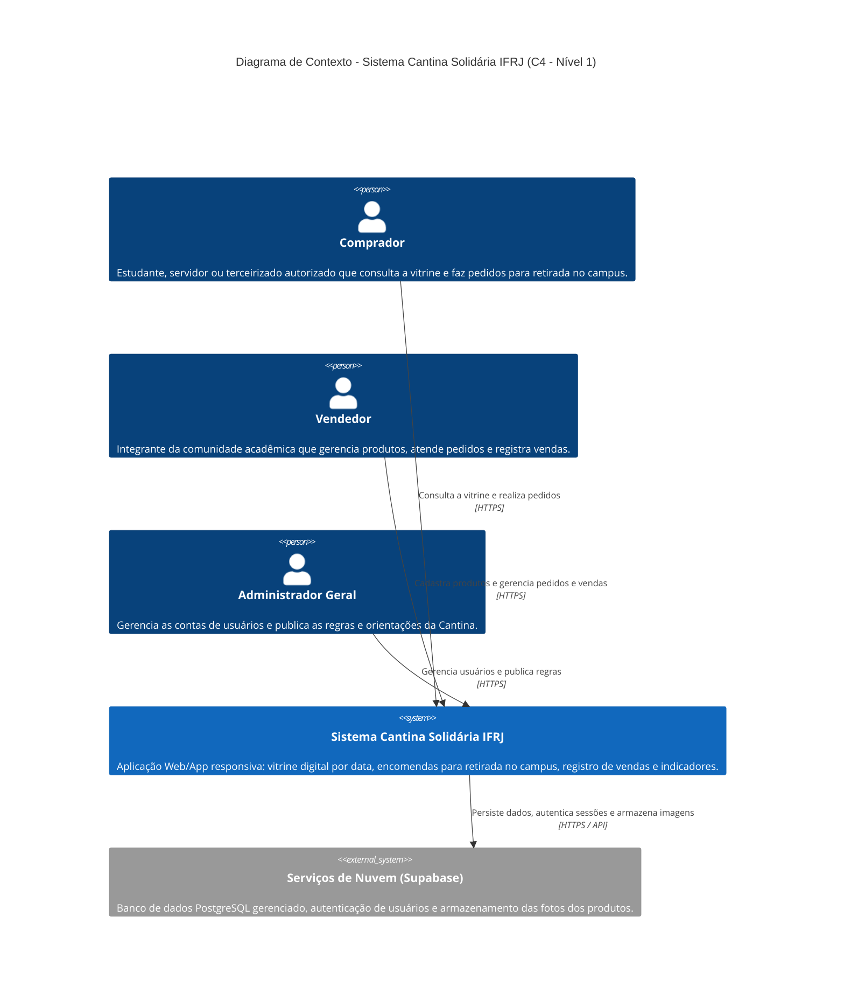
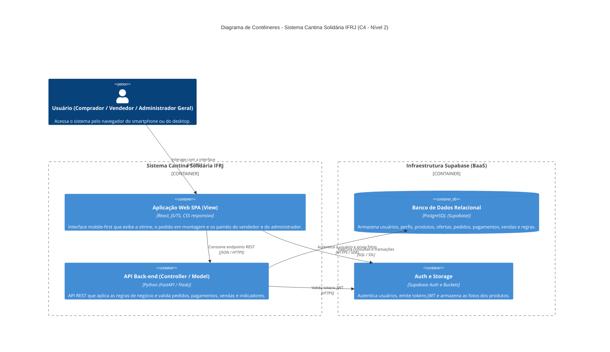
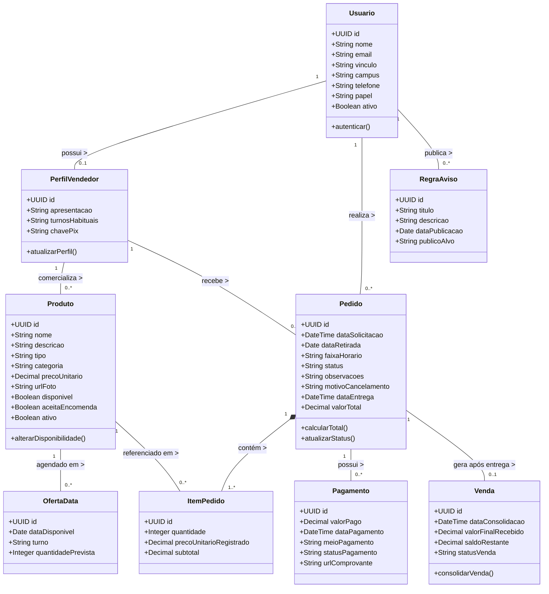
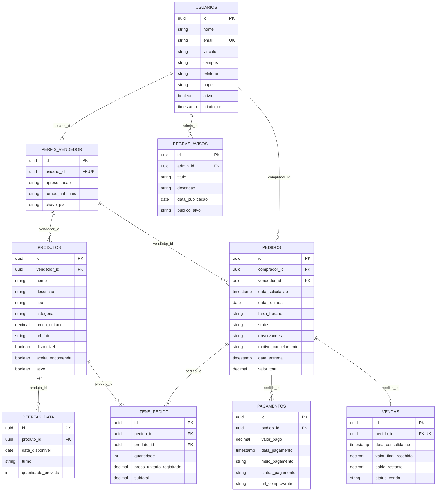

# DOCUMENTAÇÃO TÉCNICA DO PROJETO INTEGRADOR DE ENGENHARIA DE SOFTWARE

**Sistema Web/App da Cantina Solidária do IFRJ**

| Campo | Informação |
| :--- | :--- |
| **Equipe** | Equipe Cão |
| **Integrantes** | Marcelo Oliveira, Cauê Augusto e Gabriel Pires |
| **Tema/Contexto da solução** | Sistema Web/App de vitrine digital, encomendas e gestão comercial para a Cantina Solidária do IFRJ (Campus Niterói) |
| **Repositório Git** | https://github.com/CaueAugustoSilva/SistemaDeCantinaSolidaria |
| **Wiki de planejamento e documentação do projeto** | https://github.com/CaueAugustoSilva/SistemaDeCantinaSolidaria/wiki |
| **Quadro Kanban** | https://github.com/CaueAugustoSilva/SistemaDeCantinaSolidaria/projects |
| **Semestre** | 2026.2 |

---

## CONTROLE DE VERSÕES DA DOCUMENTAÇÃO

| Versão | Data | Atividade/Entrega | Responsável(is) | Principais alterações |
| :--- | :--- | :--- | :--- | :--- |
| **1.0** | 12/11/2026 | Entrega AV1 – Documentação técnica inicial | Cauê Augusto, Gabriel Pires e Marcelo Oliveira | Elaboração inicial: contexto, escopo do MVP, requisitos (RF, RNF e RN), modelos C4 (níveis 1 e 2), diagrama de classes, modelo lógico, estilo arquitetural e decisões tecnológicas. |

---

## 1. CONTEXTO E OBJETIVO DA SOLUÇÃO

### 1.1 Contexto do problema

A Cantina Solidária do IFRJ (Campus Niterói) reúne iniciativas de comercialização de alimentos e bebidas realizadas por integrantes da própria comunidade acadêmica, incluindo estudantes e servidores. Atualmente, essas atividades ocorrem sem apoio tecnológico sistematizado para a divulgação da oferta, o registro de encomendas e o acompanhamento das vendas.

Esse cenário gera dificuldades para os dois lados da relação comercial no campus:

* **Compradores** (estudantes, docentes, técnicos-administrativos e terceirizados autorizados): não conseguem saber com antecedência quais alimentos estarão disponíveis, em quais dias e turnos, por quais vendedores e a que preços.
* **Vendedores:** sem um canal organizado, têm baixa previsibilidade da produção diária, dificuldade para controlar pedidos e vendas e maior risco de desperdício de alimentos ou de falta de produtos.

**Públicos e cenários de uso.** O sistema atende três perfis: Comprador, Vendedor (que também pode comprar) e Administrador Geral. Nos cenários típicos, (i) o comprador consulta pelo celular, antes de ir ao campus ou nos intervalos, o que será vendido em determinada data e registra um pedido para retirada; (ii) o vendedor publica sua oferta, decide sobre cada pedido recebido, prepara e entrega os itens e registra o pagamento; e (iii) o administrador mantém as contas de usuários e divulga as regras de participação. O uso ocorre principalmente em smartphones.

**Informações registradas e consultadas.** Cadastros de usuários e vínculos institucionais, perfis de vendedor, catálogo de produtos com disponibilidade por data, pedidos e seus itens, registros manuais de pagamento, vendas consolidadas e regras e orientações da Cantina.

**Fontes do levantamento.** A descrição baseia-se no documento de referência fornecido pelo cliente, “Proposta de Desenvolvimento de um Sistema Web/App da Cantina Solidária do IFRJ”, que detalha os módulos funcionais (M1 a M8), os fluxos desejados, os perfis de usuário e as prioridades do Produto Mínimo Viável (MVP). Como a própria proposta ressalva, ela não substitui o levantamento com os responsáveis pela Cantina: permanecem a validar com o cliente as regras de participação, os locais e horários de retirada, a política de cancelamentos, as condições de pagamento e as responsabilidades sobre dados pessoais.

| Elemento | Síntese do problema |
| :--- | :--- |
| **O problema de** | realizar a divulgação, a encomenda e o controle comercial de alimentos na Cantina Solidária sem suporte tecnológico sistematizado |
| **afeta** | compradores (estudantes, servidores e terceirizados autorizados) e vendedores da comunidade acadêmica do IFRJ |
| **cujo impacto é** | o desconhecimento prévio da oferta diária por parte dos compradores, a baixa previsibilidade de produção para os vendedores, falhas no controle de pedidos e vendas e o risco de desperdício ou de falta de produtos |
| **uma boa solução seria** | um Sistema Web/App responsivo e intuitivo que funcione como vitrine digital por data, organize o fluxo de pedidos e encomendas para retirada no campus e apoie o registro de vendas e de indicadores gerenciais |

---

### 1.2 Escopo do projeto (proposta de solução tecnológica)

A solução proposta é um **Sistema Web/App responsivo**, otimizado para smartphones e também utilizável em navegadores desktop. Ele funcionará como vitrine digital e ferramenta de organização comercial para retirada presencial no campus, respeitando o caráter solidário da iniciativa: não há intermediação financeira automatizada nem serviço de entrega externa.

O objetivo principal do MVP é entregar, de forma completa e estável, o ciclo essencial: **consulta à oferta → solicitação do pedido → aceite ou recusa pelo vendedor → preparo e retirada → registro da venda**.

#### Macrofuncionalidades incluídas no MVP (prioridade P1)

| Módulo | Objetivo e recursos no MVP |
| :--- | :--- |
| **M1 – Contas, vínculos e perfis** | Cadastro mínimo e login; perfis de Comprador, Vendedor (que também pode comprar) e Administrador Geral previamente cadastrado; perfil do vendedor; suspensão e reativação de contas pelo administrador. |
| **M2 – Vitrine e disponibilidade** | Cadastro, edição e pausa de produtos pelo vendedor (nome, descrição, tipo, categoria, preço, foto opcional, aceite de encomenda e situação disponível/esgotado); definição das datas de oferta; vitrine consultável por data, categoria e vendedor. |
| **M3 – Pedidos e encomendas** | Pedido de um único vendedor por vez, com vários itens e quantidades, data de retirada, observações e total estimado; consulta e acompanhamento da situação pelo comprador. |
| **M4 – Atendimento e retirada** | Painel do vendedor com os pedidos recebidos; aceite ou recusa; atualização para Em Preparo, Pronto para Retirada e Entregue; cancelamento com justificativa. |
| **M5 – Pagamentos e vendas** | Registro manual do pagamento (valor, meio e situação) e consolidação da venda após a entrega, mantendo pedido, pagamento e venda como registros distintos. |
| **M6 – Histórico de compras** | Consulta básica dos pedidos e das compras anteriores do comprador. |
| **M7 – Relatórios e indicadores** | Resumo simples por vendedor: pedidos por situação, vendas concluídas e receita registrada. |
| **M8 – Administração e regras** | Acesso administrativo básico e seção com as regras de participação e orientações gerais da Cantina. |

Em relação à priorização sugerida na proposta do cliente, a equipe optou por antecipar para o MVP as situações Em Preparo e Cancelado (M4), o registro do meio de pagamento e da situação parcial (M5) e a publicação das regras pelo administrador (M8), de modo a cobrir o ciclo completo do pedido. Os campos de turno, quantidade prevista, chave Pix e comprovante existem no modelo de dados apenas como informações opcionais.

#### Fora do escopo do MVP (evoluções P2/P3)

* Validação de matrículas e vínculos por planilha institucional importada e autorização prévia de terceirizados.
* Recorrência semanal da oferta, controle automático de quantidade por data e filtros por características alimentares.
* Integração com gateways de pagamento, conciliação automática de Pix e tratamento de devoluções em cancelamentos.
* Registro de vendas presenciais sem encomenda prévia.
* Notificações externas automatizadas por WhatsApp ou e-mail.
* Agenda de atividades da Cantina (mesões, oficinas e formações) e lembretes.
* Ticket médio, ranking de produtos, filtros por período, dashboards avançados e exportação de relatórios.
* Pontuação de fidelidade, descontos, avaliações de vendedores e perfis complementares (dados socioeconômicos e preferências).

---

### 1.3 Requisitos da solução tecnológica

Os requisitos a seguir delimitam o MVP (módulos M1 a M8, prioridade P1) e foram derivados da proposta do cliente. Cada regra de negócio indica os requisitos funcionais aos quais se relaciona.

#### 1.3.1 Requisitos funcionais (RF)

| Código | Descrição do requisito funcional |
| :--- | :--- |
| **RF01** | O sistema deve permitir que usuários realizem cadastro básico e login, assumindo os papéis de Comprador, Vendedor ou ambos, além do perfil de Administrador Geral. |
| **RF02** | O sistema deve permitir que o Vendedor cadastre, edite, pause ou remova produtos de sua vitrine, informando nome, descrição, tipo (comida/bebida), categoria, preço unitário, foto opcional, se aceita encomenda e status de disponibilidade. |
| **RF03** | O sistema deve permitir que o Vendedor configure as datas em que cada produto estará disponível para retirada ou encomenda. |
| **RF04** | O sistema deve exibir uma vitrine digital permitindo que o Comprador consulte e filtre produtos disponíveis por data de retirada, categoria e vendedor. |
| **RF05** | O sistema deve sinalizar visualmente os itens marcados como “Esgotado”, bloqueando a inclusão desses itens em novos pedidos. |
| **RF06** | O sistema deve permitir que o Comprador monte um pedido contendo um ou mais itens de um mesmo vendedor, especificando quantidades, data de retirada e observações, exibindo o valor total estimado antes da confirmação. |
| **RF07** | O sistema deve registrar todo novo pedido enviado pelo Comprador com o status inicial “Pendente”. |
| **RF08** | O sistema deve permitir que o Vendedor visualize a fila de pedidos recebidos com detalhes dos itens, quantidades, observações e dados do comprador, podendo “Aceitar” ou “Recusar” (com motivo) cada solicitação. |
| **RF09** | O sistema deve permitir que o Vendedor atualize o ciclo de atendimento dos pedidos aceitos para “Em Preparo”, “Pronto para Retirada” e “Entregue” (ou “Cancelado”, mediante justificativa). |
| **RF10** | O sistema deve permitir que o Vendedor registre manualmente o pagamento de um pedido (valor pago, meio de pagamento e status: pendente, parcial ou total) e consolide a venda após a entrega. |
| **RF11** | O sistema deve permitir que o Comprador consulte seu histórico de pedidos e acompanhe, no próprio sistema, as alterações de situação de cada pedido (aceite, recusa, preparo, disponibilidade para retirada, entrega ou cancelamento). |
| **RF12** | O sistema deve exibir ao Vendedor um resumo gerencial simples contendo o total de pedidos por situação, a quantidade de vendas concluídas e a receita registrada. |
| **RF13** | O sistema deve disponibilizar uma seção para consulta das regras de participação e orientações gerais da Cantina Solidária, gerenciável pelo Administrador Geral. |
| **RF14** | O sistema deve permitir que o Vendedor mantenha seu perfil de vendedor (apresentação, turnos habituais no campus e, opcionalmente, chave Pix a ser informada ao comprador). |
| **RF15** | O sistema deve permitir que o Administrador Geral consulte os usuários cadastrados e suspenda ou reative contas. |

---

#### 1.3.2 Requisitos não funcionais (RNF)

| Código | Categoria | Descrição do requisito não funcional |
| :--- | :--- | :--- |
| **RNF01** | Usabilidade e Responsividade | A interface web deve seguir abordagem *mobile-first*, adaptando-se a telas de smartphones (a partir de 360 px de largura) e a navegadores desktop. |
| **RNF02** | Portabilidade | A aplicação deve ser compatível com as versões atuais dos principais navegadores móveis e desktop (Google Chrome, Safari, Firefox e Microsoft Edge). |
| **RNF03** | Desempenho | O tempo de carregamento da vitrine de produtos e a resposta às requisições da API devem ser inferiores a 2 segundos em condições normais de conexão 4G/Wi-Fi. |
| **RNF04** | Segurança e Controle de Acesso | As senhas dos usuários devem ser armazenadas com algoritmos de hash seguros (via Supabase Auth), e as rotas da API que consultam ou alteram dados de usuários, pedidos, pagamentos e vendas devem exigir autenticação via token (JWT). |
| **RNF05** | Segurança e Controle de Acesso | Dados comerciais detalhados, históricos financeiros e informações de contato devem ser acessíveis estritamente aos usuários autorizados (vendedor proprietário, comprador envolvido ou administrador). |
| **RNF06** | Manutenibilidade | O código-fonte deve seguir a separação de responsabilidades do padrão arquitetural MVC, facilitando testes unitários e a futura inclusão das funcionalidades P2 e P3. |
| **RNF07** | Disponibilidade | O sistema deve operar em ambiente de nuvem com disponibilidade mínima de 99% durante o horário de funcionamento acadêmico do campus (07h às 22h). |
| **RNF08** | Acessibilidade | A interface deve adotar as práticas das WCAG 2.1 (nível AA) aplicáveis ao MVP: contraste mínimo de 4,5:1 nos textos, rótulos em todos os campos de formulário, texto alternativo nas fotos dos produtos e navegação por teclado nas telas principais. |
| **RNF09** | Proteção de Dados Pessoais | O sistema deve coletar apenas os dados pessoais necessários ao cadastro e à compra (nome, vínculo, campus, e-mail e telefone), em conformidade com a LGPD (Lei nº 13.709/2018), sem exigir dados sensíveis ou socioeconômicos no MVP. |
| **RNF10** | Restrições de Projeto e Tecnológicas | A solução deve ser implementada com React no front-end, Python no back-end e PostgreSQL gerenciado pelo Supabase, com o código versionado no GitHub. |

---

#### 1.3.3 Regras de negócio (RN)

| Código | Descrição da regra de negócio | Requisitos |
| :--- | :--- | :--- |
| **RN01** | **Unicidade de vendedor por pedido:** um pedido deve conter itens de um único vendedor. Caso o comprador selecione produtos de vendedores diferentes, o sistema deve gerar pedidos distintos. | RF06 |
| **RN02** | **Reserva condicionada ao aceite:** o envio de um pedido pelo comprador não garante a reserva automática do produto; a reserva efetiva ocorre somente após o aceite explícito do vendedor. | RF07, RF08 |
| **RN03** | **Integridade histórica de preços:** o preço unitário de um item registrado no momento da criação do pedido deve ser preservado no histórico, mesmo que o vendedor altere posteriormente o valor do produto no catálogo. | RF02, RF06, RF11 |
| **RN04** | **Separação entre pedido, pagamento e venda:** um pedido aceito não constitui uma venda concluída. A venda só é contabilizada nos indicadores financeiros após a confirmação da entrega e o registro do valor efetivamente recebido. | RF09, RF10, RF12 |
| **RN05** | **Exclusão de pedidos não concluídos da receita:** pedidos com status *Pendente*, *Recusado* ou *Cancelado* nunca devem ser somados aos relatórios de receita realizada do vendedor. | RF12 |
| **RN06** | **Preservação de histórico na remoção de produtos:** ao pausar ou excluir um produto da vitrine, o sistema deve realizar exclusão lógica (*soft delete*), mantendo intactos os registros de pedidos e vendas passadas vinculados àquele item. | RF02, RF11 |
| **RN07** | **Ausência de intermediação bancária:** o sistema não processa transações financeiras nem valida transferências bancárias automaticamente; toda confirmação de pagamento ou sinal é declaratória e registrada manualmente pelo vendedor. | RF10 |
| **RN08** | **Ciclo de situações do pedido:** todo pedido segue a sequência Pendente → Aceito → Em Preparo → Pronto para Retirada → Entregue, sendo a etapa Em Preparo opcional em pedidos para retirada no mesmo dia. A recusa só é possível a partir de Pendente; o cancelamento, sempre com motivo, só é possível enquanto o pedido não estiver Entregue. Entregue, Recusado e Cancelado são situações finais. | RF07, RF08, RF09 |
| **RN09** | **Vitrine restrita a datas vigentes e itens disponíveis:** a vitrine exibe apenas produtos ativos com oferta cadastrada para a data atual ou para datas futuras. Itens esgotados permanecem visíveis e sinalizados; itens esgotados, pausados ou sem oferta na data de retirada escolhida não podem ser incluídos em novos pedidos. | RF03, RF04, RF05, RF06 |
| **RN10** | **Encomenda para data futura:** pedidos para retirada em data futura só são permitidos para produtos marcados como “aceita encomenda”; os demais só podem ser pedidos para retirada no próprio dia da oferta. | RF02, RF06 |
| **RN11** | **Cálculo do valor do pedido:** o subtotal de cada item é a quantidade multiplicada pelo preço unitário registrado no pedido, e o valor total é a soma dos subtotais. A quantidade de cada item deve ser um número inteiro maior ou igual a 1. | RF06 |
| **RN12** | **Contas e perfis:** o Administrador Geral é previamente cadastrado, não havendo autocadastro nesse perfil. Apenas usuários com perfil de vendedor publicam produtos e atendem pedidos. Contas suspensas não acessam o sistema, e seus registros históricos são preservados. | RF01, RF14, RF15 |

---

## 2. DESIGN E ARQUITETURA DA SOLUÇÃO

### 2.1 Modelo de arquitetura — contexto do sistema (C4, nível 1)

O diagrama de contexto posiciona o Sistema Cantina Solidária IFRJ em relação aos três perfis de usuários da comunidade acadêmica (Comprador, Vendedor e Administrador Geral) e aos serviços de nuvem do Supabase, único sistema externo previsto no MVP. Nesta versão não há integração com gateways de pagamento, serviços de mensagens ou sistemas acadêmicos do IFRJ.

*Figura 1 – Diagrama de contexto do Sistema Cantina Solidária IFRJ (C4, nível 1).*

---

### 2.2 Modelo de arquitetura — contêineres (C4, nível 2)

O diagrama de contêineres detalha a divisão técnica da solução em front-end (SPA em React), back-end (API REST em Python) e camada de dados e autenticação (Supabase), indicando como as requisições trafegam entre cliente, servidor e banco de dados. O front-end acessa o Supabase diretamente apenas para autenticar o usuário e enviar fotos; as operações de negócio passam pela API.

*Figura 2 – Diagrama de contêineres do Sistema Cantina Solidária IFRJ (C4, nível 2).*

---

### 2.3 Diagrama de classes do domínio da solução

O diagrama de classes representa as principais entidades de domínio do MVP, com seus atributos, associações e multiplicidades, e reflete a separação entre Produto, Pedido, Pagamento e Venda definida nas regras RN03 e RN04.

*Figura 3 – Diagrama de classes UML do domínio da solução.*

O atributo `papel` (Usuario) indica se a conta é de Comprador, de Vendedor, de ambos ou de Administrador Geral, e o atributo `status` (Pedido) assume as situações definidas na RN08. Os atributos `turno` e `quantidadePrevista` (OfertaData), `chavePix` (PerfilVendedor) e `urlComprovante` (Pagamento) são opcionais no MVP.

---

### 2.4 Modelo lógico (relacional) do banco de dados

O modelo lógico foi projetado para o PostgreSQL (Supabase) e deriva diretamente do diagrama de classes: cada classe originou uma tabela, e as associações foram mapeadas por chaves estrangeiras. O quadro após a figura lista os atributos e as chaves de cada tabela.

*Figura 4 – Modelo lógico relacional (PK: chave primária; FK: chave estrangeira; UK: valor único).*

| Tabela | Atributos e chaves |
| :--- | :--- |
| **USUARIOS** | `id` [PK], `nome`, `email` [UNIQUE], `vinculo`, `campus`, `telefone`, `papel`, `ativo`, `criado_em` |
| **PERFIS_VENDEDOR** | `id` [PK], `usuario_id` [FK → USUARIOS.id, UNIQUE], `apresentacao`, `turnos_habituais`, `chave_pix` |
| **PRODUTOS** | `id` [PK], `vendedor_id` [FK → PERFIS_VENDEDOR.id], `nome`, `descricao`, `tipo`, `categoria`, `preco_unitario`, `url_foto`, `disponivel`, `aceita_encomenda`, `ativo` |
| **OFERTAS_DATA** | `id` [PK], `produto_id` [FK → PRODUTOS.id], `data_disponivel`, `turno`, `quantidade_prevista` |
| **PEDIDOS** | `id` [PK], `comprador_id` [FK → USUARIOS.id], `vendedor_id` [FK → PERFIS_VENDEDOR.id], `data_solicitacao`, `data_retirada`, `faixa_horario`, `status`, `observacoes`, `motivo_cancelamento`, `data_entrega`, `valor_total` |
| **ITENS_PEDIDO** | `id` [PK], `pedido_id` [FK → PEDIDOS.id], `produto_id` [FK → PRODUTOS.id], `quantidade`, `preco_unitario_registrado`, `subtotal` |
| **PAGAMENTOS** | `id` [PK], `pedido_id` [FK → PEDIDOS.id], `valor_pago`, `data_pagamento`, `meio_pagamento`, `status_pagamento`, `url_comprovante` |
| **VENDAS** | `id` [PK], `pedido_id` [FK → PEDIDOS.id, UNIQUE], `data_consolidacao`, `valor_final_recebido`, `saldo_restante`, `status_venda` |
| **REGRAS_AVISOS** | `id` [PK], `admin_id` [FK → USUARIOS.id], `titulo`, `descricao`, `data_publicacao`, `publico_alvo` |

#### Decisões de modelagem

* **Integridade histórica de preços (RN03):** `ITENS_PEDIDO.preco_unitario_registrado` guarda o preço vigente na criação do pedido, independentemente de alterações posteriores em `PRODUTOS.preco_unitario`.
* **Exclusão lógica (RN06) e suspensão de contas (RF15):** as colunas `ativo` de PRODUTOS e de USUARIOS evitam a remoção física de registros referenciados por pedidos e vendas.
* **Separação entre pedido, pagamento e venda (RN04):** um pedido pode ter vários registros em PAGAMENTOS e, no máximo, uma venda, pois `VENDAS.pedido_id` é único.
* **Vendedor único por pedido (RN01):** cada pedido referencia um único vendedor em `PEDIDOS.vendedor_id`.
* **Recusa, cancelamento e entrega:** `PEDIDOS.motivo_cancelamento` registra a justificativa informada na recusa ou no cancelamento, e `PEDIDOS.data_entrega` registra a data e a hora da retirada.

---

### 2.5 Estilo arquitetural e justificativa

#### Estilo adotado: MVC (Model-View-Controller) em arquitetura cliente-servidor

A solução será estruturada segundo o padrão arquitetural MVC, desacoplado sobre uma comunicação cliente-servidor via API REST:

* **View (camada de apresentação, front-end):** responsável exclusivamente pela renderização da interface responsiva, pela interação com o usuário (vitrine, carrinho, formulários de cadastro e painéis) e pela exibição dos estados retornados pela API.
* **Controller (camada de controle, back-end):** recebe as requisições HTTP provenientes da View, valida permissões e parâmetros de entrada, aciona as regras de negócio (como a separação de pedidos por vendedor e o cálculo de totais) e devolve respostas estruturadas em JSON.
* **Model (camada de domínio e persistência, back-end e banco):** encapsula as entidades de negócio (Usuário, Produto, Pedido, Pagamento e Venda), suas validações de estado e a comunicação com o banco de dados relacional.

#### Diferenciação entre estilo arquitetural e tecnologias

O MVC define a organização lógica e a separação de responsabilidades do software (como os dados, as regras e a interface se comunicam), independentemente das ferramentas usadas. Já React, Python e Supabase são as escolhas concretas de implementação que materializam cada camada desse padrão.

#### Justificativa da escolha

* **Aderência aos requisitos:** o sistema exige múltiplas visões para os mesmos dados (comprador, vendedor e administrador).
* **Manutenibilidade e evolução incremental:** o isolamento das regras de negócio facilita as futuras entregas P2 e P3 sem comprometer a interface (RNF06).
* **Produtividade da equipe:** a separação permite o desenvolvimento paralelo de front-end e back-end pelos três integrantes.

---

## 3. DECISÕES TECNOLÓGICAS

O quadro a seguir relaciona as tecnologias selecionadas para o desenvolvimento do MVP, com suas finalidades e justificativas técnicas.

| Camada / área | Tecnologia escolhida | Finalidade no projeto | Justificativa técnica |
| :--- | :--- | :--- | :--- |
| **Front-end (View)** | **React** (HTML5, CSS3, JS/TS) | Construção da interface web responsiva (*SPA*) para smartphones e desktops. | Permite componentização reutilizável (cards de produtos, filtros, status), boa performance em dispositivos móveis e ecossistema maduro. |
| **Back-end (Controller / Model)** | **Python** (FastAPI / Flask) | Desenvolvimento da API REST, das regras de negócio, das validações e dos indicadores. | Sintaxe limpa, alta produtividade e bom suporte à manipulação de dados e relatórios (útil para os indicadores e para as futuras planilhas da fase P2). |
| **Banco de dados (persistência)** | **Supabase (PostgreSQL)** | Armazenamento relacional persistente de usuários, produtos, pedidos, pagamentos e vendas. | Oferece PostgreSQL gerenciado gratuitamente, com integridade transacional (ACID), essencial para pedidos e vendas. |
| **Autenticação e armazenamento de arquivos** | **Supabase Auth e Storage** | Gerenciamento de login e sessões (JWT) e hospedagem das fotos dos produtos. | Elimina a complexidade de implementar do zero servidores de arquivos e criptografia de senhas, acelerando a entrega do MVP. |
| **Versionamento e gestão** | **Git, GitHub, Wiki e Projects** | Controle de versão do código, documentação incremental e quadro Kanban. | Centraliza em um único ambiente os artefatos exigidos na disciplina (código, diagramas, documentação e rastreabilidade). |
