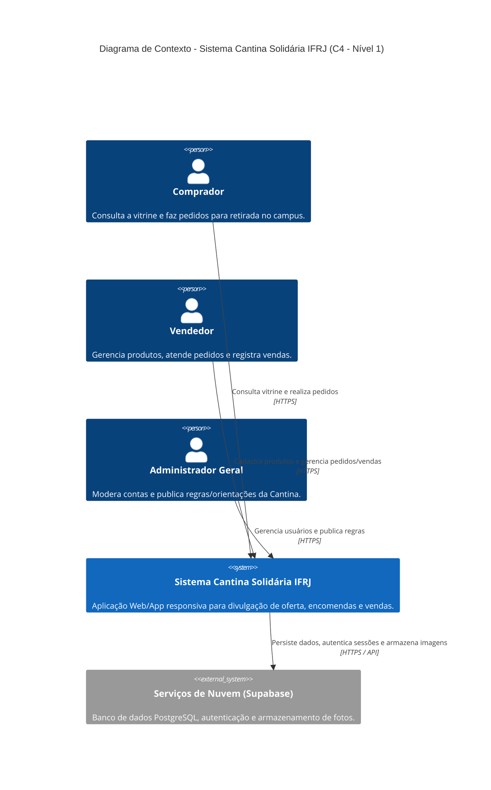
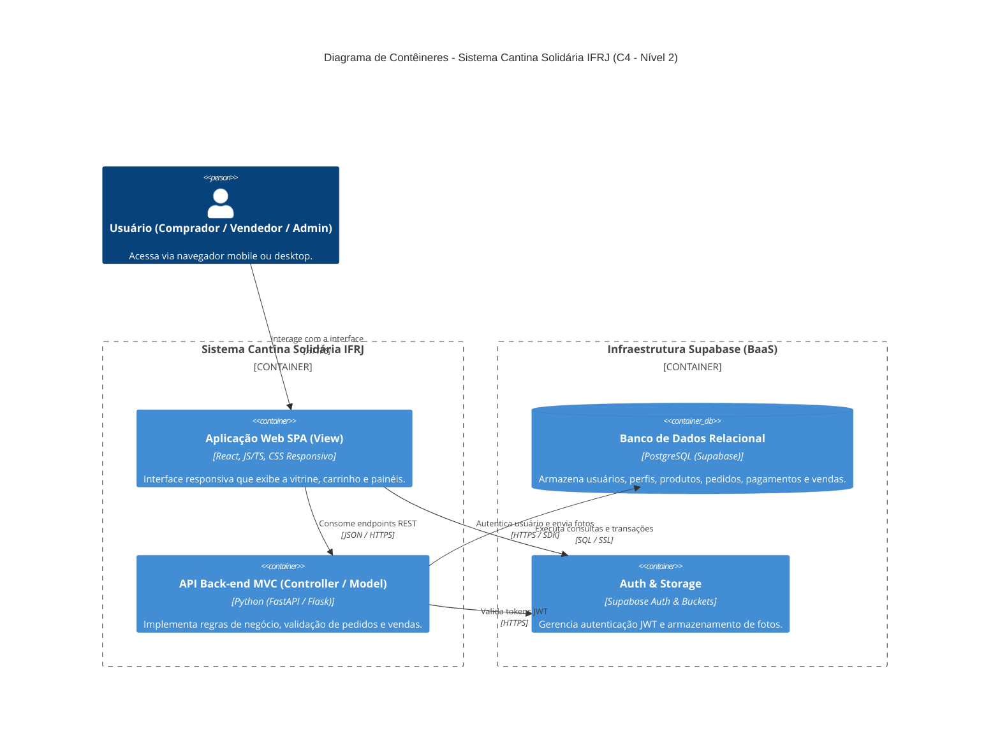
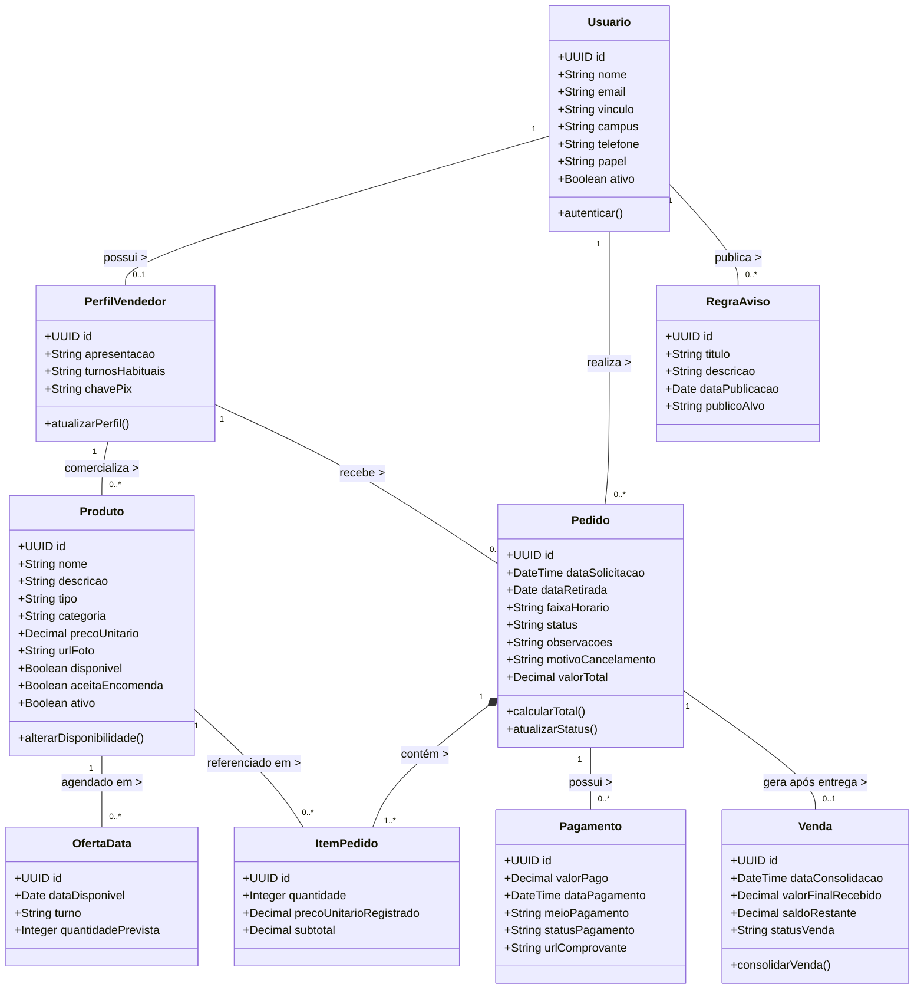

# DOCUMENTAÇÃO TÉCNICA DO PROJETO INTEGRADOR DE ENGENHARIA DE SOFTWARE

**Sistema Web/App da Cantina Solidária do IFRJ**

| Campo | Informação |
| :--- | :--- |
| **Integrantes** | Cauê Augusto, Gabriel de Oliveira e Marcelo Silva |
| **Tema / Contexto da Solução** | Sistema Web/App de Vitrine Digital, Encomendas e Gestão Comercial para a Cantina Solidária do IFRJ (Campus Niterói) |
| **Repositório Git** | https://github.com/CaueAugustoSilva/SistemaDeCantinaSolidaria |
| **Wiki de Planejamento e Documentação** | https://github.com/CaueAugustoSilva/SistemaDeCantinaSolidaria/wiki |
| **Quadro Kanban** | https://github.com/CaueAugustoSilva/SistemaDeCantinaSolidaria/projects |
| **Semestre** | 2026.2 |

---

## CONTROLE DE VERSÕES DA DOCUMENTAÇÃO

| Versão | Data | Atividade/Entrega | Responsável(is) | Principais Alterações |
| :--- | :--- | :--- | :--- | :--- |
| **1.0** | 12/11/2026 | Entrega AV1 – Documentação Técnica Inicial | Cauê Augusto Silva [e equipe] | Elaboração inicial do contexto, escopo do MVP, especificação de requisitos (RF, RNF, RN), modelagem C4 (Níveis 1 e 2), Diagrama de Classes UML, Modelo Lógico e definições arquiteturais/tecnológicas. |

---

## 1. CONTEXTO E OBJETIVO DA SOLUÇÃO

### 1.1 Contexto do Problema
A Cantina Solidária do IFRJ (Campus Niterói) reúne iniciativas de comercialização de alimentos e bebidas realizadas por integrantes da própria comunidade acadêmica, incluindo estudantes e servidores. Atualmente, essas atividades ocorrem sem apoio tecnológico sistematizado para a divulgação da oferta, registro de encomendas e acompanhamento das vendas.

Esse cenário gera dificuldades operacionais relevantes para os dois lados da relação comercial no campus:
* **Para compradores (estudantes, docentes, técnicos-administrativos e terceirizados autorizados):** Falta visibilidade antecipada sobre quais alimentos estarão disponíveis no campus, em quais dias e turnos, por quais vendedores e a quais preços.
* **Para vendedores:** A ausência de um canal organizado reduz a previsibilidade da produção diária, dificulta o controle de pedidos e vendas realizadas e aumenta o risco de desperdício de alimentos ou falta de produtos.

A fundamentação deste levantamento baseou-se no documento de referência fornecido pelo cliente (*Proposta de Desenvolvimento de um Sistema Web/App da Cantina Solidária do IFRJ*), que detalha os fluxos desejados, perfis de usuário e prioridades para o Produto Mínimo Viável (MVP). As informações centrais a serem registradas e consultadas envolvem cadastros de usuários e vínculos institucionais, catálogos de produtos com disponibilidade por data, pedidos/encomendas, registros manuais de pagamento e consolidação de vendas.

| Elemento | Síntese do Problema |
| :--- | :--- |
| **O problema de** | realizar a divulgação, encomenda e controle comercial de alimentos na Cantina Solidária sem suporte tecnológico sistematizado |
| **afeta** | compradores (estudantes, servidores e terceirizados) e vendedores da comunidade acadêmica do IFRJ |
| **cujo impacto é** | o desconhecimento prévio da oferta diária por parte dos compradores, a baixa previsibilidade de produção para os vendedores, falhas no controle de pedidos/vendas e o risco de desperdício ou falta de produtos |
| **uma boa solução seria** | desenvolver um Sistema Web/App responsivo e intuitivo que funcione como vitrine digital por data e turno, organize o fluxo de pedidos/encomendas para retirada no campus e apoie o registro de vendas e indicadores gerenciais |

---

### 1.2 Escopo do Projeto (Proposta de Solução Tecnológica)
A solução proposta consiste em um **Sistema Web/App responsivo**, otimizado para uso em dispositivos móveis (smartphones) e navegadores desktop. O sistema atuará como uma vitrine digital e ferramenta de organização comercial para retirada presencial no campus, respeitando o caráter solidário da iniciativa — sem intermediação financeira automatizada ou serviços de entrega externa.

O objetivo principal do MVP é entregar uma experiência completa, estável e funcional cobrindo o ciclo essencial: **consulta à oferta → solicitação de pedido → aceite/recusa do vendedor → preparo e retirada → registro da venda**.

#### Macrofuncionalidades Incluídas no MVP (Prioridade P1)
* **M1 – Contas, Vínculos e Perfis:** Autenticação e cadastro mínimo de usuários com perfis de Comprador, Vendedor (que também pode comprar) e Administrador Geral previamente cadastrado.
* **M2 – Vitrine e Disponibilidade:** Cadastro, edição e pausamento de produtos pelo vendedor (nome, descrição, categoria, preço, foto opcional e status disponível/esgotado), com exibição pública da vitrine filtrada por data.
* **M3 – Pedidos e Encomendas:** Criação de pedidos vinculados a um único vendedor por vez (contendo múltiplos itens e quantidades), escolha da data de retirada, cálculo do valor total e acompanhamento do status pelo comprador.
* **M4 – Atendimento e Retirada:** Painel do vendedor para listar pedidos recebidos, aceitar ou recusar solicitações e atualizar status para *Pronto para retirada* e *Entregue*.
* **M5 – Pagamentos e Vendas:** Separação lógica entre pedido e venda concluída; registro manual de pagamentos (valor e situação) e consolidação da venda após a entrega.
* **M6 – Histórico de Compras:** Consulta básica de pedidos anteriores e status de compras pelo comprador.
* **M7 – Relatórios e Indicadores:** Resumo simples de pedidos e vendas concluídas por vendedor.
* **M8 – Administração e Regras:** Acesso administrativo básico e exibição das regras estáticas de participação da Cantina Solidária.

#### Fora do Escopo do MVP (Evoluções Futuras – P2/P3)
* Importação automatizada ou via planilha para validação de matrículas institucionais.
* Integração com gateways de pagamento bancário ou conciliação automática de Pix.
* Notificações externas automatizadas via API do WhatsApp ou e-mail.
* Sistema de pontuação de fidelidade, avaliações de vendedores e exportação avançada de dashboards.

---

### 1.3 Requisitos da Solução Tecnológica

#### 1.3.1 Requisitos Funcionais (RF)

| Código | Descrição do Requisito Funcional |
| :--- | :--- |
| **RF01** | O sistema deve permitir que usuários realizem cadastro básico e login, assumindo os papéis de Comprador, Vendedor ou ambos, além do perfil de Administrador Geral. |
| **RF02** | O sistema deve permitir que o Vendedor cadastre, edite, pause ou remova produtos de sua vitrine, informando nome, descrição, tipo (comida/bebida), categoria, preço unitário, foto opcional e status de disponibilidade. |
| **RF03** | O sistema deve permitir que o Vendedor configure as datas em que cada produto estará disponível para retirada ou encomenda. |
| **RF04** | O sistema deve exibir uma vitrine digital permitindo que o Comprador consulte e filtre produtos disponíveis por data de retirada, categoria e vendedor. |
| **RF05** | O sistema deve sinalizar visualmente os itens marcados como "Esgotado", bloqueando a inclusão desses itens em novos pedidos. |
| **RF06** | O sistema deve permitir que o Comprador monte um pedido contendo um ou mais itens de um mesmo vendedor, especificando quantidades, data de retirada e observações, exibindo o valor total estimado antes da confirmação. |
| **RF07** | O sistema deve registrar todo novo pedido enviado pelo Comprador com o status inicial "Pendente". |
| **RF08** | O sistema deve permitir que o Vendedor visualize a fila de pedidos recebidos com detalhes dos itens, quantidades, observações e dados do comprador, podendo "Aceitar" ou "Recusar" (com motivo) cada solicitação. |
| **RF09** | O sistema deve permitir que o Vendedor atualize o ciclo de atendimento dos pedidos aceitos para "Em Preparo", "Pronto para Retirada" e "Entregue" (ou "Cancelado" mediante justificativa). |
| **RF10** | O sistema deve permitir que o Vendedor registre manualmente o pagamento de um pedido (valor pago, meio de pagamento e status: pendente, parcial ou total) e consolide a venda após a entrega. |
| **RF11** | O sistema deve permitir que o Comprador consulte seu histórico de pedidos e acompanhe as atualizações de status em tempo real. |
| **RF12** | O sistema deve exibir ao Vendedor um resumo gerencial simples contendo o total de pedidos por situação, quantidade de vendas concluídas e receita registrada. |
| **RF13** | O sistema deve disponibilizar uma seção para consulta das regras de participação e orientações gerais da Cantina Solidária, gerenciável pelo Administrador Geral. |

---

#### 1.3.2 Requisitos Não Funcionais (RNF)

| Código | Categoria | Descrição do Requisito Não Funcional |
| :--- | :--- | :--- |
| **RNF01** | **Usabilidade e Responsividade** | A interface web deve seguir abordagem *mobile-first*, adaptando-se perfeitamente a telas de smartphones (a partir de 360px de largura) e navegadores desktop. |
| **RNF02** | **Portabilidade** | A aplicação deve ser compatível com as versões atuais dos principais navegadores móveis e desktop (Google Chrome, Safari, Firefox e Microsoft Edge). |
| **RNF03** | **Desempenho** | O tempo de carregamento da vitrine de produtos e a resposta às requisições da API devem ser inferiores a 2 segundos em condições normais de conexão 4G/Wi-Fi. |
| **RNF04** | **Segurança e Privacidade** | As senhas dos usuários devem ser armazenadas utilizando algoritmos de hash seguros (via Supabase Auth), e as rotas da API devem exigir autenticação via token (JWT). |
| **RNF05** | **Controle de Acesso** | Dados comerciais detalhados, históricos financeiros e informações de contato devem ser acessíveis estritamente aos usuários autorizados (vendedor proprietário, comprador envolvido ou administrador). |
| **RNF06** | **Manutenibilidade** | O código-fonte deve seguir a separação de responsabilidades do padrão arquitetural **MVC**, facilitando testes unitários e a futura inclusão das funcionalidades P2 e P3. |
| **RNF07** | **Disponibilidade** | O sistema deve operar em ambiente em nuvem com disponibilidade mínima de 99% durante o horário de funcionamento acadêmico do campus (07h às 22h). |

---

#### 1.3.3 Regras de Negócio (RN)

| Código | Descrição da Regra de Negócio | Requisitos |
| :--- | :--- | :--- |
| **RN01** | **Unicidade de Vendedor por Pedido:** Um pedido deve conter itens de apenas um único vendedor. Caso o comprador selecione produtos de vendedores diferentes, o sistema deve gerar pedidos distintos. | RF06 |
| **RN02** | **Reserva Condicionada ao Aceite:** O envio de um pedido pelo comprador não garante a reserva automática do produto; a reserva efetiva ocorre somente após o aceite explícito do vendedor. | RF07, RF08 |
| **RN03** | **Integridade Histórica de Preços:** O preço unitário de um item registrado no momento da criação do pedido deve ser preservado no histórico, mesmo que o vendedor altere o valor do produto no catálogo posteriormente. | RF02, RF06, RF11 |
| **RN04** | **Separação entre Pedido, Pagamento e Venda:** Um pedido aceito não constitui uma venda concluída. A venda só é contabilizada nos indicadores financeiros após a confirmação de entrega e registro do valor efetivamente recebido. | RF09, RF10, RF12 |
| **RN05** | **Exclusão de Pedidos Não Concluídos na Receita:** Pedidos com status *Pendente*, *Recusado* ou *Cancelado* nunca devem ser somados aos relatórios de receita realizada do vendedor. | RF12 |
| **RN06** | **Preservação de Histórico na Remoção de Produtos:** Ao pausar ou excluir um produto da vitrine, o sistema deve realizar exclusão lógica (*soft delete*), mantendo intactos os registros de pedidos e vendas passadas vinculados àquele item. | RF02, RF11 |
| **RN07** | **Ausência de Intermediação Bancária:** O sistema não processa transações financeiras nem valida transferências bancárias automaticamente; toda confirmação de pagamento ou sinal é declaratória e registrada manualmente pelo vendedor. | RF10 |

---

## 2. DESIGN E ARQUITETURA DA SOLUÇÃO

### 2.1 Modelo de Arquitetura – Contexto do Sistema (C4, Nível 1)
O diagrama de contexto apresenta o **Sistema da Cantina Solidária do IFRJ** no centro das interações com os três perfis de usuários da comunidade acadêmica (Comprador, Vendedor e Administrador Geral) e com os serviços de nuvem do Supabase.

---

### 2.2 Modelo de Arquitetura – Contêineres (C4, Nível 2)
O diagrama de contêineres detalha a divisão técnica da aplicação em **Front-end (SPA em React)**, **Back-end (API REST em Python)** e **Camada de Dados e Autenticação (Supabase)**, evidenciando como as requisições trafegam entre cliente, servidor e banco de dados.

---

### 2.3 Diagrama de Classes do Domínio da Solução (UML)
O diagrama de classes representa as principais entidades de domínio identificadas no levantamento de requisitos, refletindo a separação entre **Produto**, **Pedido**, **Pagamento** e **Venda**.

---

### 2.4 Modelo Lógico (Relacional) do Banco de Dados
O modelo lógico foi projetado para o banco de dados **PostgreSQL (Supabase)**, garantindo integridade referencial, preservação histórica de preços nos itens de pedido e rastreabilidade financeira:

| Tabela | Atributos e Chaves |
| :--- | :--- |
| **USUARIOS** | `id` [PK], `nome`, `email` [UNIQUE], `vinculo`, `campus`, `telefone`, `papel`, `ativo`, `criado_em` |
| **PERFIS_VENDEDOR** | `id` [PK], `usuario_id` [FK -> USUARIOS.id, UNIQUE], `apresentacao`, `turnos_habituais`, `chave_pix` |
| **PRODUTOS** | `id` [PK], `vendedor_id` [FK -> PERFIS_VENDEDOR.id], `nome`, `descricao`, `tipo`, `categoria`, `preco_unitario`, `url_foto`, `disponivel`, `aceita_encomenda`, `ativo` |
| **OFERTAS_DATA** | `id` [PK], `produto_id` [FK -> PRODUTOS.id], `data_disponivel`, `turno`, `quantidade_prevista` |
| **PEDIDOS** | `id` [PK], `comprador_id` [FK -> USUARIOS.id], `vendedor_id` [FK -> PERFIS_VENDEDOR.id], `data_solicitacao`, `data_retirada`, `faixa_horario`, `status`, `observacoes`, `motivo_cancelamento`, `valor_total` |
| **ITENS_PEDIDO** | `id` [PK], `pedido_id` [FK -> PEDIDOS.id], `produto_id` [FK -> PRODUTOS.id], `quantidade`, `preco_unitario_registrado`, `subtotal` |
| **PAGAMENTOS** | `id` [PK], `pedido_id` [FK -> PEDIDOS.id], `valor_pago`, `data_pagamento`, `meio_pagamento`, `status_pagamento`, `url_comprovante` |
| **VENDAS** | `id` [PK], `pedido_id` [FK -> PEDIDOS.id, UNIQUE], `data_consolidacao`, `valor_final_recebido`, `saldo_restante`, `status_venda` |
| **REGRAS_AVISOS** | `id` [PK], `admin_id` [FK -> USUARIOS.id], `titulo`, `descricao`, `data_publicacao`, `publico_alvo` |

---

### 2.5 Estilo Arquitetural e Justificativa

#### Estilo Adotado: MVC (Model-View-Controller) em Arquitetura Cliente-Servidor
A solução será estruturada seguindo o padrão arquitetural **MVC (Model-View-Controller)** desacoplado sobre uma comunicação Cliente-Servidor via API REST:
* **View (Camada de Apresentação – Front-end):** Responsável exclusivamente pela renderização da interface responsiva, interação com o usuário (vitrine, carrinho, formulários de cadastro e painéis) e exibição dos estados retornados pela API.
* **Controller (Camada de Controle – Back-end):** Recebe as requisições HTTP provenientes da View, valida permissões e parâmetros de entrada, aciona as regras de negócio (como a separação de pedidos por vendedor e cálculo de totais) e devolve respostas estruturadas em JSON.
* **Model (Camada de Domínio e Persistência – Back-end + Banco):** Encapsula as entidades de negócio (Usuário, Produto, Pedido, Pagamento, Venda), suas validações de estado e a comunicação com o banco de dados relacional.

#### Diferenciação entre Estilo Arquitetural e Tecnologias
O **MVC** define a organização lógica e a separação de responsabilidades do software (como os dados, as regras e a interface se comunicam), independentemente das ferramentas usadas. Já **React**, **Python** e **Supabase** são as escolhas concretas de implementação que materializam cada camada desse padrão.

#### Justificativa da Escolha
A escolha do MVC justifica-se por três fatores principais:
1. **Aderência aos requisitos:** O sistema exige múltiplas visões para os mesmos dados (comprador, vendedor e administrador).
2. **Manutenibilidade e evolução incremental:** O isolamento das regras de negócio facilita as futuras entregas P2 e P3 sem comprometer a interface.
3. **Produtividade da equipe:** Permite desenvolvimento paralelo entre front-end e back-end.

---

## 3. DECISÕES TECNOLÓGICAS

A tabela abaixo apresenta as tecnologias selecionadas para o desenvolvimento do MVP, suas finalidades e justificativas técnicas:

| Camada / Área | Tecnologia Escolhida | Finalidade no Projeto | Justificativa Técnica |
| :--- | :--- | :--- | :--- |
| **Front-end (View)** | **React** (HTML5, CSS3, JS/TS) | Construção da interface web responsiva (*SPA*) para smartphones e desktops. | Permite componentização reutilizável (cards de produtos, filtros, status), boa performance mobile e ecossistema maduro. |
| **Back-end (Controller / Model)** | **Python** (FastAPI / Flask) | Desenvolvimento da API REST, regras de negócio, validações e indicadores. | Sintaxe limpa, alta produtividade e excelente suporte para manipulação de dados e relatórios (útil para indicadores e futuras planilhas na fase P2). |
| **Banco de Dados (Persistência)** | **Supabase (PostgreSQL)** | Armazenamento relacional persistente de usuários, produtos, pedidos, pagamentos e vendas. | Oferece PostgreSQL gerenciado gratuitamente, garantindo integridade transacional (ACID) essencial para pedidos e vendas. |
| **Autenticação e Storage** | **Supabase Auth & Storage** | Gerenciamento de login/sessões (JWT) e hospedagem das fotos dos produtos. | Elimina a complexidade de implementar servidores de arquivos e criptografia de senhas do zero, acelerando a entrega do MVP. |
| **Versionamento e Gestão** | **Git, GitHub, Wiki e Projects** | Controle de versão do código, documentação incremental e quadro Kanban. | Centraliza todos os artefatos exigidos na disciplina (código, diagramas, documentação e rastreabilidade) em um único ambiente. |
